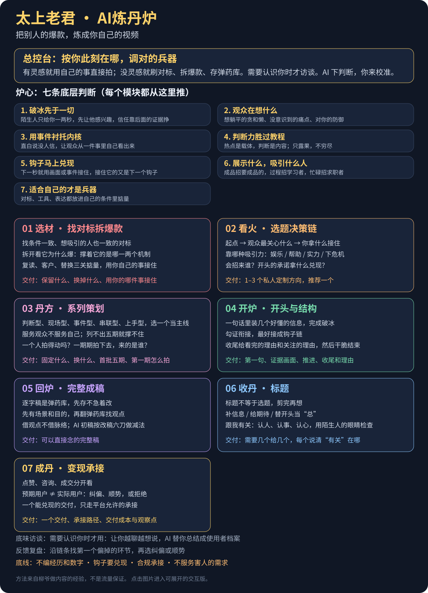

# 太上老君·AI炼丹炉

**先认识你，再帮你炼丹。教的是创作思路，让你做出自己的内容。**

*上图可直接查看；点击图片进入可展开的交互版。*

这套技能面向想做自媒体的小白，也帮助已有内容的创作者解决某一步的问题。来自柳爷对自己作品的口述复盘：怎样选参考、想选题、用现场素材、安排开头和证据、写成自己的话，再从实际反馈调整。

面向不同赛道，不只 AI；也支持不变现的生活记录。经验不等于所有赛道均已验证，不承诺播放、涨粉或收入。

## 怎么用

- 没方向：聊一件你做过的事，帮助发现值得拍的内容。
- 有参考：掂量口吻、观众、实现条件，决定如何为自己所用。
- 有题没稿：设计主线、开头与证据，按需完成逐字稿和拍摄建议。
- 已有内容：只改开头、标题或某一段，不重来整套流程。
- 发过但不对劲：比较想吸引的人与实际反馈，找到下一步该改哪里。

每个建议说清为什么适合这次用户。访谈按需启动，一次问一个问题；已有材料直接使用。语言样本不足不妨碍先完成一个小任务。

## 核心方法保留

| 单元 | 判断方法 |
|---|---|
| 总入口 | 先看用户阶段与材料，调用必要模块，做完即停 |
| 选材 | 掂量三关：复读、客户/观众、替换；不是计分淘汰公式 |
| 看火 | 人群、认知、钩子、可验证、低门槛；结合目标判断 |
| 开炉 | 场景服务目的，勾证衔接，信息做减法；五段式按内容选用 |
| 回炉 | 参考作为弹药库，借观点不借原句脉络；负责完整逐字稿 |
| 收丹 | 跟我有关三源；标题与口播、画面分担信息 |
| 成丹 | 预期与实际需求对照，点赞/咨询/付费分开判断 |
| 底味与去AI味 | 从本人原话找表达习惯，只改有具体问题的句子，不造事实 |

## 下载后给智能体什么

**只想给一份文件：** [Bot版完整流程](bot-prompt/liuye-bot-prompt.md)。

**支持技能文件的智能体：** 整个仓库作为项目，或一起安装 skills 下七个子目录（含参考文件）。详见[安装说明](docs/install-guide.md)。不假定所有宿主都兼容，实测边界见[验证说明](docs/validation.md)。

方法阅读：[配方全集](docs/formulas.md)；[访谈框架](docs/flavor-interview.md)；[去AI味](docs/deai-rulebook.md)。[本地全景图](docs/mindmap/炼丹炉全景图.html)可下载后在浏览器打开；[在线预览](https://liuhaisi2026212-maker.github.io/taishang-laojun/mindmap/preview.html)展示远程 main，未发布的本地修复不会出现在该页面。

## 方法来源与维护

创作者：柳爷（柳爷不迷糊）。核心经验来自本人作品的创作意图、过程与反馈复盘；作者口述的效果不等于逐条因果验证。个人材料不随仓库发布，也不要求使用者模仿作者的题材。

结构设计参考 [dontbesilent/dbskill](https://github.com/dontbesilent2025/dbskill)。去AI味观察框架参考 humanizer / Humanizer-zh，保留[第三方声明](THIRD-PARTY-NOTICES.md)。

规则维护在 skills 及 references。修改后运行 `python3 scripts/build_views.py` 同步人读版/Bot，运行 `python3 scripts/check_package.py` 检查分发完整性。全景图与讲稿需同步检查，不能单独改变执行规则。

## 许可

本体沿用 [CC BY-NC 4.0](LICENSE)。第三方内容见其原许可；本说明不另授商业使用权。使用者的个人素材、底味和客户资料不进公共仓库。
